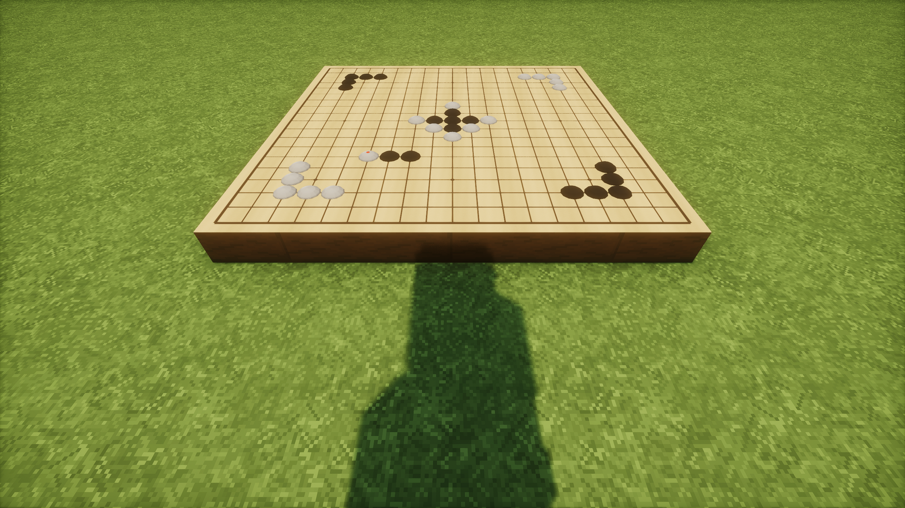
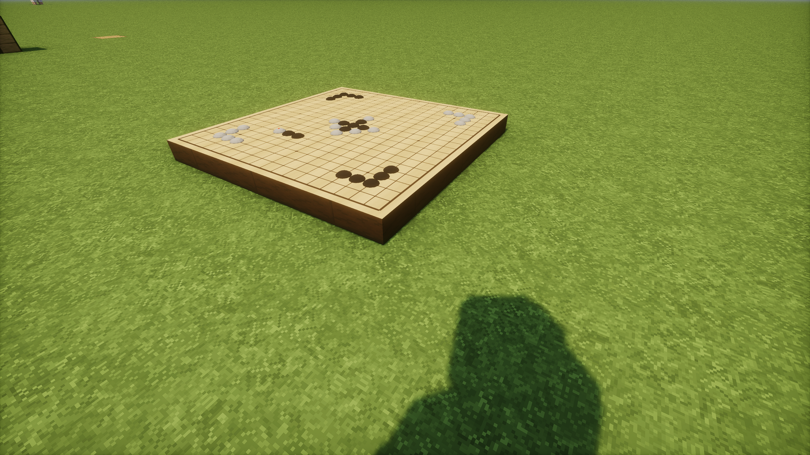
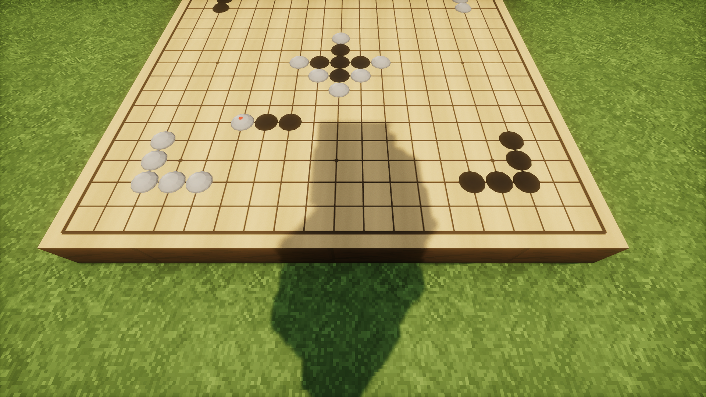

# mcgo — Go / Weiqi (围棋) for Minecraft

A server-authoritative 19×19 Go board you can place in the world. Two players (or one, in solo mode)
play a full game under **Chinese rules with area scoring**, with automatic dead-stone detection,
a confirmation phase, SGF export, undo, and a 3×3-block wooden table you can actually walk on.

**Minecraft 1.21.1 · Fabric · client + server required**

---

## Screenshots







---

## Features

### The board
- A **3×3 block** wooden table (0.25 blocks tall — you walk onto it without jumping).
- The whole board surface is **procedurally generated** at runtime (wood grain, 19 grid lines, 9 star points).
  No image files are shipped, which is why the jar stays under 200 KB.
- Two styles: **A — kaya light wood / ivory-black stones**, **C — rosewood / onyx**. Switch with `/mcgo style c`.
- Stones are low-poly biconvex lenses (12 segments) rendered from board state — not blocks, not entities.

### Playing
- **Right-click with an empty hand** → opens the 19×19 GUI: hover highlight, click to place.
- **Sneak + right-click** → places directly in the world with a translucent ghost-stone preview.
- **Two input channels, one coordinate mapping** — the GUI and the world click share the same math.

### Rules (Chinese / area scoring)
- Liberties, capture, **suicide is forbidden**, **positional superko** (simple ko is a special case).
- Komi **3¾ stones (7.5 points)**; black wins above `(361 − dame)/2 + 3.75`.
- **Dame is split**; seki territory is counted (Chinese rules), so no special-casing is needed.

### End of game
- Two consecutive passes → scoring phase.
- Dead stones are **suggested automatically**: floating-stone heuristic + Monte Carlo run **twice**
  (once with each side moving first; only results both runs agree on are trusted), plus an
  "unconditionally alive" whitelist so living groups can't be marked dead by accident.
- Click a stone to toggle **the whole string**; `Shift+click` overrides a protected group.
- Both players must **confirm**; a dispute returns to play. Five minutes of inactivity settles the game
  automatically. The result reads e.g. `黑胜 1¾ 子（3.5 目）`.

### Quality of life
- **Solo mode** — one player controls both colours, confirms once, plays a whole game alone.
- **Undo** — instant in solo; in two-player mode the opponent must accept.
- **Clear board (清盘)** — wipes the game; a solo game restarts a fresh one immediately.
- **Move broadcast** — players within 48 blocks see `黑 D4` in the action bar.
- **Sounds** — stone placement and capture, three variants each.
- **SGF export** — manual button, plus **automatic** once the game is settled.
  Files go to `config/mcgo/sgf/`; dead stones are recorded as `TB`/`TW` territory (the OGS convention),
  so Sabaki / Lizzie / any SGF reader restores the final position correctly.

---

## Requirements

| | |
|---|---|
| Minecraft | **1.21.1** |
| Loader | Fabric Loader **≥ 0.19.5** |
| API | **Fabric API 0.116.17+1.21.1** |
| Java | **21** |
| Environment | **both client and server** (a custom block plus renderer can't appear on vanilla clients) |

## Installation

1. Drop `mcgo-0.1.0.jar` into `mods/` **on the server and on every client**.
2. Restart.
3. Craft the board: **9 planks (any wood type) in a 3×3 grid**. In creative it sits under *Functional Blocks*.

## How to play

| Action | How |
|---|---|
| Open the GUI | right-click the board with an empty hand |
| Place a stone in the world | **sneak + right-click** (ghost preview follows your crosshair) |
| Seat / start | GUI: `执黑` / `执白`, or **`单人模式`** to play both sides |
| Pass / resign | GUI buttons |
| Undo | GUI button (two-player: your opponent must accept) |
| Clear the board | GUI button `清盘` (available when empty or finished) |
| Save the record | GUI button `保存棋谱` → the path is printed in chat |
| Switch wood style | `/mcgo style a` · `/mcgo style c` |

### Commands

```
/mcgo info                  show the state of the board you're looking at
/mcgo style <a|c>           switch board style
/mcgo place <x> <y> <b|w>   place a stone (debug / scripting)
/mcgo pass <b|w>            pass (debug / scripting)
/mcgo seat <b|w>            take a seat
/mcgo resign <b|w>          resign
/mcgo force                 force-settle the scoring phase (permission 2)
/mcgo reset                 wipe the game immediately
```

---

## Known limitations

- Only **19×19**; other board sizes are not implemented.
- Chinese / area scoring only — no Japanese territory scoring.
- No AI opponent.
- Undo history is in memory only: after a server restart you cannot undo moves from the previous session.
- The board is fully server-authoritative; spectators beyond chunk-tracking range won't see updates until
  they come closer (normal vanilla behaviour).
- Requires the mod on both sides — vanilla clients see nothing.

## Building from source

```
./gradlew build          # jar lands in build/libs/
./gradlew runServer      # dev server
```

Toolchain: Gradle 9.5.1, Loom 1.17.19, JDK 21, Mojang official mappings.

---

## Credits

- **Fabric Loader / Fabric API** — the mod platform.
- **Sabaki** (MIT, https://github.com/SabakiHQ/Sabaki) — the bundled stone and capture sounds are Sabaki's
  `data/*.mp3`, transcoded to mono Vorbis. The MIT copyright notice is preserved in
  `mcgo-sounds-NOTICE.txt` inside the jar. **Keep that file if you redistribute this mod.**
- The dead-stone heuristic and the dual Monte-Carlo rollout idea follow **Sabaki's `@sabaki/deadstones`**
  and the scoring discussion in **OGS's `score-estimator`** — design references only, no code copied.
- Board texture, stone texture, item icon and mod icon are **generated procedurally by this mod's code**.
- Rules reference: 中国围棋规则 (2002), area scoring with 3¾ stone komi.

Not affiliated with Mojang or Microsoft. "Minecraft" is a trademark of Mojang Synergies AB.

## License

Mod code: **MIT**. Bundled sound effects: **MIT** (Sabaki), see the notice file.

---

# 中文说明

一个能放进世界里的 **19×19 围棋棋盘**：3×3 格木台、服务端裁决、支持双人对弈与单人自弈，
采用**中国规则数子法**，带自动死子判定、双方确认、SGF 棋谱导出、悔棋与清盘。

## 特性

- **棋盘**：3×3 格、高 0.25 格，可直接走上去；盘面 1024×1024 由代码**程序化生成**，不打包任何图片。
- **两套风格**：A 榧木浅黄 / C 深紫檀，`/mcgo style c` 切换。
- **两条落子通道**：空手右击开 GUI；**蹲下右击**在世界里直接落子（带半透明预览子）。
- **规则**：气、提子、**禁自杀**、**位置超劫**（单劫是其特例）、黑贴 3¾ 子。
- **终局**：连续两次停手 → 数子。自动标出疑似死子（浮子启发式 + 蒙特卡洛双跑取一致结果 +
  绝对活白名单保护），点一颗 = 整串切换，`Shift+点击` 可强制覆盖；**双方确认**后结算，
  异议可退回对局，5 分钟无操作自动结算。
- **单人模式**：一个人执双方，确认一次即出结果。
- **悔棋**：单人立即生效；双人需对方同意。
- **清盘**：清空对局，单人局清盘后自动开新局。
- **播报**：48 格内的玩家在动作栏看到「黑 D4」。
- **音效**：落子音与提子音，各 3 个变体。
- **SGF**：手动保存 + **终局自动保存**，落在 `config/mcgo/sgf/`，死子按 OGS 惯例写成 `TB`/`TW` 地属性。

## 合成

工作台上 **9 个任意木板**（3×3 摆满）→ 棋盘。创造模式在「功能方块」里。

## 安装

把 jar 放进**服务端和每个客户端**的 `mods/`，需要 Fabric Loader ≥ 0.19.5、Fabric API 0.116.17+1.21.1、Java 21。

## 致谢

- **Fabric** 提供加载器与 API。
- **Sabaki**（MIT）提供落子/提子音效原始素材，已转码为 ogg；MIT 版权声明保留在 jar 内
  `mcgo-sounds-NOTICE.txt`，**再分发时请勿删除**。
- 死子启发式与「蒙特卡洛双跑取交集」的思路参考 **Sabaki `@sabaki/deadstones`** 与 **OGS `score-estimator`**，
  仅借鉴思路，未复制代码。
- 盘面、棋子、物品图标、mod 图标全部由本模组代码程序化生成。
- 规则依据：中国围棋规则（2002），数子法，黑贴 3¾ 子。

## 许可

代码 MIT；音效 MIT（Sabaki）。与 Mojang / 微软无隶属关系。
